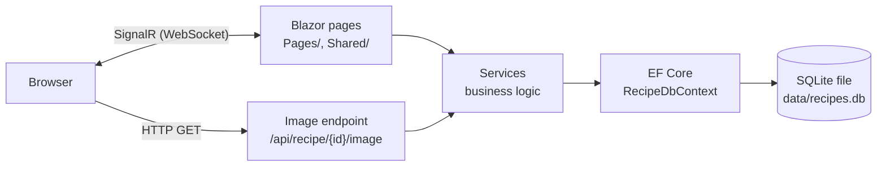

# Recipes

[](https://github.com/Zstehura/Recipes/actions/workflows/ci.yml)
[](https://github.com/Zstehura/Recipes/actions/workflows/codeql.yml)
[](https://codecov.io/gh/Zstehura/Recipes)

A self-hosted recipe manager built with .NET 10, Blazor Server, and SQLite. Store your recipes, manage a shared ingredient library, generate a combined grocery list, and find recipes by what you have on hand. It runs as a single Docker container on a home server.

## Contents

- [Features](#features)
- [Screenshots](#screenshots)
- [Tech stack](#tech-stack)
- [Getting started (Docker)](#getting-started-docker)
- [Local development](#local-development)
- [Architecture](#architecture)
- [Testing](#testing)
- [Design decisions](#design-decisions)
- [Security](#security)
- [Known limitations](#known-limitations)
- [Import format](#import-format)

## Features

- **Recipes:** create, edit, and delete recipes with ingredients, instructions, cooking time, servings, tags, notes, and a photo
- **Ingredient library:** one shared list of ingredients, with default units, renaming, and merging of duplicates
- **Search and filtering:** search by name, ingredient, or tag, and filter by cooking time, servings, and tags
- **Search by available ingredients:** find the recipes that use everything you've selected
- **Grocery list:** pick recipes, set how many batches of each, and get one combined list. Quantities are added up across recipes and shown in readable units (for example 1.2 kg rather than 1200 g)
- **Import and export:** move recipes in and out as a plain-text format (see [Import format](#import-format))
- **Unsaved work survives:** a half-written recipe, the grocery list, and search filters come back after switching apps on a phone, a lost connection, a page reload, or a server restart

## Screenshots

> **TODO (owner):** add screenshots under `docs/screenshots/` and replace each placeholder below with an image link, e.g. ``.

| Screen | Screenshot |
|---|---|
| Recipe list | _Placeholder: `docs/screenshots/recipe-list.png`_ |
| Recipe detail | _Placeholder: `docs/screenshots/recipe-detail.png`_ |
| Recipe form | _Placeholder: `docs/screenshots/recipe-form.png`_ |
| Grocery list | _Placeholder: `docs/screenshots/grocery-list.png`_ |
| Search by ingredients | _Placeholder: `docs/screenshots/search-by-ingredients.png`_ |

## Tech stack

| Area | Choice |
|---|---|
| Runtime | .NET 10 (LTS) |
| UI | Blazor Server, Bootstrap 5, Bootstrap Icons |
| Data | Entity Framework Core 10 with SQLite |
| Tests | xUnit, NSubstitute, Shouldly, coverlet, `WebApplicationFactory` |
| CI and security | GitHub Actions, CodeQL, Dependabot, Codecov |
| Hosting | Docker (multi-stage build, chiseled non-root runtime image), Docker Compose |

## Getting started (Docker)

### Prerequisites

- [Docker](https://docs.docker.com/get-docker/) and [Docker Compose](https://docs.docker.com/compose/install/)

### Quick start

1. Clone the repository:
   ```bash
   git clone https://github.com/Zstehura/Recipes.git
   cd Recipes
   ```

2. Create the data folder and give it to the container's user. The app runs as a non-root user (UID 1654), so it needs write access to this folder:
   ```bash
   mkdir -p data
   sudo chown 1654:1654 data
   ```
   (On Docker Desktop for macOS or Windows, `mkdir -p data` is enough.)

3. Build and start the container:
   ```bash
   docker compose up -d
   ```

4. Open `http://localhost:5000` in your browser (or `http://<server-ip>:5000` from another device on your network).

The database is a single SQLite file in the `data/` folder on the host, mounted into the container, so your recipes persist across container restarts and rebuilds. To back up, copy that folder.

### Updating

Pull the latest changes and rebuild:
```bash
git pull
docker compose up -d --build
```

**Upgrading from a version that ran as root** (before the non-root image): the existing `data/` folder is owned by root, so give it to the container's user once, before rebuilding:
```bash
sudo chown -R 1654:1654 data
```
If the container then fails to start with "unable to open database file", the folder ownership is the cause.

When a new version changes the database structure, the app upgrades the database automatically on startup and first writes a backup next to it (`data/recipes.db.backup-<timestamp>`). Once you've confirmed everything works, you can delete the backup.

### Configuration

The default port mapping is `5000:8080`. To change the host port, edit [docker-compose.yml](docker-compose.yml):

```yaml
ports:
  - "3000:8080"  # change 3000 to your desired port
```

## Local development

### Prerequisites

- .NET 10 SDK, or Docker only (see [CONTRIBUTING.md](CONTRIBUTING.md) for running everything in the SDK container)

### Running

```bash
dotnet run
```

The app is available at `http://localhost:5000`. The SQLite database is created at `Data/recipes.db` on first run.

### Running tests

```bash
dotnet test
```

[CONTRIBUTING.md](CONTRIBUTING.md) covers running tests with Docker only, collecting coverage, formatting, and what CI checks.

## Architecture



Blazor Server runs the UI on the server. The browser keeps a SignalR connection open, sends UI events over it, and receives rendering updates back. Pages call services directly, with no separate HTTP API in between. The one exception is recipe images, which are served by a plain HTTP endpoint so the browser can load and cache them like any other image.

```
Models/          Entities (Recipe, Ingredient, RecipeIngredient) and the IngredientEntry form model
Data/            RecipeDbContext and DatabaseInitializer (creates and upgrades the database)
Services/        Business logic:
                   RecipeService, IngredientService        recipe and ingredient data access
                   GroceryListService                      combining recipes into a grocery list
                   RecipeImportExportService               the text import/export format
                   UnitConversionService                   unit conversion to and from base units
                   RecipeValidator, ImageValidator         server-side validation
                   RecipeTags, IngredientEntryMapper       small shared helpers
Services/Drafts/ Unsaved page state kept in encrypted browser storage (DraftService, IDraftStore)
Pages/           Blazor pages, plus the error page
Shared/          Layout and navigation
wwwroot/         Static assets (CSS, Bootstrap)
tests/           xUnit test project (see Testing)
.github/         CI, CodeQL, and Dependabot configuration
```

## Testing

```bash
dotnet test
```

The suite has over 300 tests and runs in about a second. CI runs it on every push and pull request, along with a formatting check and a Docker image build that is then started and smoke-tested.

### Strategy

| Layer | Folder | What it tests | How |
|---|---|---|---|
| Unit | `tests/Recipes.Tests/Unit` | Pure logic: unit conversion, import/export parsing, grocery list totals, validation, tag parsing | Plain inputs and outputs, mostly data-driven (`[Theory]`). No database |
| Data | `tests/Recipes.Tests/Data` | `RecipeService`, `IngredientService`, and the database upgrade | A real SQLite database in memory, created fresh for each test |
| Component | `tests/Recipes.Tests/Components` | Pages saving, restoring, and clearing drafts (recipe form, grocery list, search filters) | bUnit renders the real pages against the SQLite test database, with an in-memory draft store in place of browser storage |
| Integration | `tests/Recipes.Tests/Integration` | The image endpoint, security headers, and the production error page | The full ASP.NET Core pipeline in memory via `WebApplicationFactory`, with a temporary database file |

Principles:

- **Arrange-Act-Assert**, with names like `Method_Scenario_ExpectedResult`.
- **Isolation:** every test gets its own database, so tests never depend on each other or on order.
- **Failure paths, not just the happy path:** malformed and hostile input, invalid images, oversized fields, missing records, and legacy database formats.
- **Mocks only at boundaries.** `GroceryListService` depends on a small `IRecipeReader` interface, which tests replace with an NSubstitute fake. Services whose job is talking to the database are tested against a real database instead of a mocked `DbContext`.
- **Bugs get a test first.** Each bug found during the testing work was recorded as a failing test of the intended behavior, then fixed, so the test now guards against regressions.

### What is and isn't covered

Covered (about 95–100% line coverage per service):
- All services and helpers in `Services/`
- The database upgrade path, including a check that an upgraded database has exactly the same schema as a newly created one
- The image endpoint, the security headers, and the error page

Not covered by automated tests:
- **Most page markup and event handling.** Pages are thin and delegate to services. bUnit tests cover the draft behavior of the pages that have it; the rest of the UI isn't component-tested yet.
- **Browser-only behavior,** such as copying to the clipboard, downloading files, and the small scripts in `wwwroot/js` (committing a field when a phone hides the page, the reconnect banner). The end-to-end behavior was checked in headless Chrome against the real image: frozen page and network cut for 1 and 4 minutes, a server restart, and a reload.
- **The running container, beyond a smoke test.** CI starts the built image and checks that the page, the Blazor script, and the stylesheet load and that it runs as the non-root user, but doesn't exercise the UI in a browser.

## Design decisions

**Blazor Server.** The whole app, UI included, is written in C#, with no separate front-end build and no API layer to maintain. For a single-household app on a home network, the main cost of Blazor Server, which is one open connection and some server memory per browser tab, doesn't matter. The trade-off is that page state lives in server memory and the UI depends on that connection, which phones drop whenever they suspend a background tab. Drafts handle that (next decision).

**SQLite.** One file, no database server to run or secure, and a backup is a file copy. SQLite allows only one writer at a time, which is no constraint for a few users.

**Real SQLite in memory for tests, not EF Core's InMemory provider.** The InMemory provider isn't a relational database: it doesn't enforce primary keys, unique indexes, foreign keys, cascades, or collations, and it doesn't translate LINQ to SQL. Several bugs in this project, such as a unique-key violation when a recipe listed the same ingredient twice, only show up against a real relational database. SQLite in memory gives that realism at unit-test speed.

**The Docker volume.** `docker-compose.yml` mounts the host's `data/` folder at `/app/Data`, which is where the app keeps its database. The container itself holds no state, so it can be rebuilt or replaced freely. The runtime image runs as a non-root user, so that folder must be writable by UID 1654 (see [Getting started](#getting-started-docker)).

**Database upgrades without EF migrations.** The database is created with `EnsureCreated`, which builds a new database but never changes an existing one. Each schema change since then has a small, idempotent upgrade step in `Data/DatabaseInitializer.cs` that runs at startup, backs up the database first, and is covered by tests against the old format. EF Core migrations are the standard tool and the natural next step if the schema keeps changing; adopting them would mean baselining existing databases, which wasn't worth the risk for the two changes so far.

**Quantities stored in base units.** Every quantity is stored as grams, milliliters, or pieces. That makes adding up quantities across recipes for the grocery list simple and exact. The trade-off is that the original unit isn't kept: "2 cups" is stored as 473.176 ml and shown as 473.18 ml when the recipe is edited.

**Images stored in the database.** Photos are BLOBs in SQLite, so the database file is a complete backup with nothing else to keep in sync, and no user-supplied file names ever reach the file system. List and detail queries exclude the image bytes, and images are served separately by recipe ID.

**Unsaved work: browser drafts, plus longer circuit retention.** Reproducing the "lost work when I switch apps" bug showed the cause: Blazor Server keeps a disconnected tab's state (its circuit) for only 3 minutes by default, then deletes it. The fix has two layers:
- *Drafts.* Pages with valuable input (recipe form, grocery list) save it after every change to the browser's local storage; search filters go to session storage, so they last only for the tab. Values are encrypted and signed with ASP.NET Core's data protection keys, which are now kept with the database so drafts stay readable after an update. Drafts expire after 7 days, are cleared on save or cancel, and anything corrupt or out of date is quietly discarded. An edit draft is dropped if the recipe was saved since. The logic sits behind `IDraftStore`, so it's unit-tested without a browser.
- *Longer retention.* Disconnected circuits are kept for 30 minutes instead of 3, so short absences reconnect seamlessly. Each retained circuit holds one tab's page state in server memory, a negligible cost at household scale (capped at 100 circuits).

Alternatives considered:
- **Blazor WebAssembly or Auto mode** would keep state in the browser and avoid the connection problem entirely, but it means adding an authenticated HTTP API for every operation, downloading the .NET runtime to the phone, and rewriting data access. It's a much larger change, and it still wouldn't survive the phone discarding the tab without the same kind of browser storage. Not worth it for this app.
- **.NET 10's built-in circuit state persistence** (`[PersistentState]`) restores state after the server evicts a circuit, but not after a reload, a tab discard, or a server restart. Drafts cover all of those with one mechanism. Restoring drafts when a page initializes also covers .NET 10's automatic circuit resume, so the app doesn't need both.

**Tags as a comma-separated column.** This keeps the schema small. Tag filtering is done in memory after the database applies the other filters, which is fine for a personal collection. A large catalog would use a separate tags table.

## Security

- **Uploads validated by content:** images are checked against the file signatures of an allow-list of formats (JPEG, PNG, GIF, WebP), never by file name or the content type the browser reports. SVG is excluded because it can contain scripts. The image endpoint re-checks the bytes on every request.
- **Server-side validation:** every save path goes through `RecipeValidator`, which enforces field lengths, quantity ranges, and known units. SQLite doesn't enforce column lengths itself.
- **Bounded import parsing:** imports are limited to 1 MB and ingredient lines to 500 characters, and every parser regex has a timeout. This closes a measured regular-expression denial-of-service risk.
- **Errors and logging:** users see friendly messages, not exception details. Unexpected errors are logged with structured logging (`ILogger`), and logs record IDs and counts, never recipe content. In production, unhandled errors show a generic page with a reference ID.
- **Response headers:** `X-Content-Type-Options: nosniff`, `X-Frame-Options: DENY`, and `Referrer-Policy: no-referrer`.
- **Data protection keys:** stored in `data/keys` next to the database, readable only by the container's user. They encrypt drafts and Blazor's circuit IDs. On Linux they aren't encrypted at rest, so protect the data folder the same way as the database.
- **Container:** multi-stage build, a chiseled runtime image with no shell or package manager, a non-root user, and app files that the app user can read but not modify.
- **Supply chain:** GitHub Actions are pinned to commit SHAs with least-privilege permissions, CodeQL scans the code and workflows, and Dependabot keeps NuGet packages, actions, and base images up to date.

## Known limitations

- **No authentication.** Anyone who can reach the app can view, change, or delete every recipe. It's designed for a single household on a trusted home network. Don't expose it to the internet without putting authentication in front of it (for example a reverse proxy with login).
- **Single-user design.** There are no user accounts or per-user data, and simultaneous edits to the same recipe aren't detected (the last save wins).
- **No HTTPS inside the container.** The container serves plain HTTP on port 8080. Use a reverse proxy such as Caddy, nginx, or Traefik for HTTPS.
- **Drafts belong to one browser on one device.** They aren't synced, so a recipe started on a phone can't be finished on a laptop until it's saved.
- **Photos aren't kept in drafts.** They can be up to 10 MB, too much for browser storage, so a photo has to be chosen again after a draft is restored. The notice says so.
- **The last few keystrokes can be lost** if a phone suspends the page before the field being typed in has sent its value. Everything up to the previous field is kept.
- **Large pasted imports may fail.** Blazor limits messages from the browser to 32 KB, so pasting more text than that into the import box is likely to disconnect the page. Use the file upload for large imports (up to 1 MB).
- **Original units aren't kept** (see [Design decisions](#design-decisions)).
- **No Content Security Policy yet.** Adding one requires, among other things, moving the import page's inline script into a static file.

## Import format

Recipes are imported and exported as plain text. A file can hold any number of recipes, each ending with `===== END RECIPE =====`:

```text
===== RECIPE =====
Name: Pancakes
Cooking Time: 20 minutes
Servings: 4
Tags: Breakfast, Sweet

===== INGREDIENTS =====
250g flour
2 cups milk
2 eggs (beaten)
1/2 tsp salt
butter (for the pan)

===== INSTRUCTIONS =====
Whisk everything together.
Cook on a hot buttered pan.

===== NOTES =====
Best served warm.

===== END RECIPE =====
```

- **Required:** `Name`, `Cooking Time` (in minutes), `Servings`, and the instructions section. Tags, notes, and dates are optional.
- **Ingredient lines:** quantity, optional unit, name, and an optional preparation note in parentheses. Fractions (`1/2`, `1 1/4`) are supported. A line without a quantity, like `butter (for the pan)`, is kept without one.
- **Units:** g, kg, oz, lb, ml, l, cup, tbsp, tsp, fl oz, and pieces, including plurals and long forms (`grams`, `tablespoons`). Lines without a recognized unit are counted in pieces.
- A recipe with errors is reported and skipped; the other recipes in the file are still imported. The import page has the full format guide.
